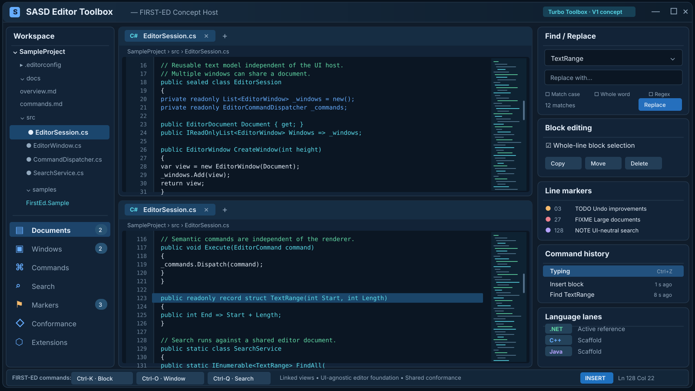

# SASD Editor Toolbox

[English](README.md) | **Deutsch**

Die **SASD Editor Toolbox** ist eine wiederverwendbare, von der Benutzeroberfläche unabhängige Grundlage für die Textbearbeitung in SASD-Anwendungen und -Werkzeugen. C#/.NET ist die erste aktiv entwickelte Referenzimplementierung. Das Repository ist inzwischen ausdrücklich so strukturiert, dass gleichberechtigte Implementierungen in C++, Java und weiteren Programmiersprachen möglich sind, ohne die Projektarchitektur neu entwerfen zu müssen.

Das langfristige Ziel geht über einen eigenständigen Texteditor hinaus: Die Toolbox soll wiederverwendbare Infrastruktur für Dokumente, Puffer, Befehle, Suche, Blöcke, Fenster, Rückgängig-Funktionen, Darstellungsmodelle und Erweiterungen bereitstellen, die in SASD-Workbench-Anwendungen eingebettet werden kann.

## Entwicklungsroadmap

Der aktuelle Implementierungsstand, die Abnahmekriterien für V1.0 und die Ausrichtung des Editor Toolkit nach V1 sind in der **[englischen Roadmap](docs/en/ROADMAP.md)** und der **[deutschen Roadmap](docs/de/ROADMAP.md)** dokumentiert. Eine funktionierende Funktion oder ein erfolgreicher CI-Lauf bedeutet für sich allein noch nicht, dass V1.0 veröffentlicht wurde.

## Vorschau der Editor-Oberfläche (Konzept)



> **Designkonzept, kein Screenshot einer Anwendung.** Diese Abbildung zeigt eine mögliche grafische Host-Anwendung für die oberflächenunabhängige Editor Toolbox: verknüpfte Dokumentfenster, Befehlsverarbeitung, Textsuche, Blockbearbeitung, Zeilenmarkierungen und sprachübergreifende Entwicklung. Die derzeit ausführbare FIRST-ED-Referenzanwendung ist terminalbasiert. Die dargestellte grafische Oberfläche und ihre Beispielwerte sind kein Nachweis bereits implementierter Funktionen.

## V1-Ziel: Kompatibilitätsumfang der Turbo Editor Toolbox

**Umsetzung der im Handbuchabgleich erkannten Lücken (Oktober 2026):** Das FIRST-ED-Konsolenbeispiel stellt inzwischen die fünf Bildschirm-Attributrollen aus dem Handbuch sowie optionale Markierungen für harte und weiche Zeilenenden und das Dateiende (EOF) am rechten Rand dar. Suchen/Ersetzen kann die bereits vom Core unterstützten Sucheinstellungen über den semantischen Befehl weiterreichen. Die Optionsbuchstaben C/W/R des Beispiels sind **modern** und werden nicht als historische `Optstr`-Syntax ausgegeben. Headless-Regressionstests decken diese Ergänzungen ab. Siehe das [Audit zur Darstellung](docs/en/FIRST-ED-PRESENTATION-V1.md), die [Suchoptionen](docs/en/FIRST-ED-SEARCH-OPTIONS-V1.md) und das [ergänzende Verzeichnis der Symbole und Funktionen](docs/en/HANDBOOK-SUPPLEMENT-V1.md). MicroStar-spezifische Menüs, Pop-up-Fenster, Druckfunktionen, Dateiwerkzeuge, Blockdateibefehle und die optionale Integration einer Rechtschreibprüfung bleiben eigenständige, noch nicht fertiggestellte Funktionen der Beispielanwendung. V1 ist hinsichtlich der historischen Kompatibilität **noch nicht abschließend abgenommen**.

Version 1 verwendet den Funktionsumfang von Borlands historischer **Turbo Editor Toolbox 1.0 (1985)** als Kompatibilitäts- und Referenzmeilenstein. Es handelt sich um eine **unabhängige Neuimplementierung (Clean Room)**: Das historische Handbuch dient als Quelle für die Anforderungen an das beobachtbare Verhalten; historischer Quellcode wird nicht kopiert.

Das historische Konzept ist besonders nützlich, weil es den Editor in Textströme, Fenster, Befehlsverteiler und -prozessoren, Erweiterungspunkte (Hooks), Dateioperationen, Bildschirmaktualisierung, gepufferte Eingabe und einen kooperativen Hintergrundmechanismus aufteilt. SASD behält diese Verantwortlichkeiten bei, stellt sie aber über moderne, testbare Abstraktionen statt über DOS- beziehungsweise videospeicherspezifischen Code bereit.

## Repository-Architektur

```text
SASD-Editor-Toolbox/
├── src/
│   ├── dotnet/                        # aktive C#/.NET-Referenzimplementierung
│   ├── cpp/                           # Grundgerüst der C++-Implementierung
│   └── java/                          # Grundgerüst der Java-Implementierung
├── tests/
│   ├── dotnet/
│   ├── cpp/
│   └── java/
├── samples/
│   ├── dotnet/
│   ├── cpp/
│   └── java/
├── spec/                              # normative, sprachunabhängige Verhaltensvorgaben
├── conformance/                       # gemeinsame maschinenlesbare Verhaltens-Testfälle
├── docs/
│   ├── en/                            # primäre technische Dokumentation
│   └── de/                            # deutsche Dokumentation
├── tools/                             # repositoryweite Prüfwerkzeuge
└── .github/workflows/
```

Die Sprachimplementierungen sind gleichberechtigt. Keine Implementierung darf zur Laufzeit von einer anderen Implementierung abhängig sein. Plattformübergreifend beobachtbares Verhalten gehört nach `spec/`; wiederverwendbare sprachübergreifende Beispiele gehören nach `conformance/`. Die .NET-Implementierung ist derzeit die vollständigste ausführbare Referenz, stellt aber nicht die normative Spezifikation dar.

## Modell für die sprachübergreifende Entwicklung

Das Repository trennt den **portablen Editor-Vertrag** von **sprachspezifischen Implementierungsentscheidungen**:

- `spec/editor-v1.md` definiert den normativen Verhaltensvertrag für V1.
- `conformance/` enthält implementierungsunabhängige Testfälle, die jeder sprachspezifische Test-Runner verarbeiten kann.
- `src/<language>`, `tests/<language>` und `samples/<language>` bilden jeweils einen eigenständigen Implementierungszweig innerhalb des Repositories.
- `implementations.json` erfasst die vorhandenen Sprachimplementierungen und ihren Reifegrad, ohne identische API-Namen vorauszusetzen.
- Jede Sprache darf idiomatische APIs, Container, Eigentums- und Speicherverwaltungsmodelle sowie Build-Systeme verwenden, solange das von außen beobachtbare Editor-Verhalten kompatibel bleibt.
- Eine semantische Änderung wird zuerst im gemeinsamen Vertrag festgehalten und anschließend in den Konformitätstests und jeder betroffenen Implementierung nachvollzogen.

Die englischen und deutschen Architekturunterlagen zur Mehrsprachigkeit beschreiben die Regeln für Portierung und Synchronisierung.

## Bereits implementierte Grundlagen

Die aktuelle Grundlage umfasst:

- eine zeilenorientierte Textpuffer-Abstraktion mit einer Implementierung auf Basis verketteter Zeilen;
- historische, vom Benutzer farblich gekennzeichnete Zeilen- und Textstrom-Annotationen als oberflächenunabhängige Flags, sodass Block- und Umbruchmetadaten auch über verknüpfte Fenster hinweg erhalten bleiben;
- Dokument- und Mehrfenster-/Sitzungsmodelle, einschließlich verknüpfter Fenster für ein gemeinsames Dokument;
- eine hostunabhängige Geometrie gestapelter Fenster über `EditorWindowLayout` / `EditorWindowFrame`;
- die historischen Regeln zum Verkleinern/Aufteilen beim Erstellen eines Fensters (Create Window) und zur Rückgewinnung von Bildschirmzeilen beim Löschen eines Fensters (Delete Window), mit mindestens drei Zeilen je angezeigtem Fenster;
- die destruktive Semantik von `EditWindowDeleteText`: ein leeres `NONAME`-Dokument, das Lösen verknüpfter Textströme, die Bereinigung von Blockzuständen und keine Wiederherstellung durch Rückgängig;
- Cursorbewegung, Einfüge- und Überschreibmodus, Zeilenwechsel, automatische Einrückung, Wortumbruch und Tabulatorverarbeitung;
- historisches FIRST-ED-Verhalten für die zeichenweise Bewegung nach links/rechts, einschließlich des zeilenübergreifenden Wechsels zur letzten nichtleeren Zeichenposition und dauerhaft zulässiger virtueller Spalten rechts vom Text, gekapselt in einem primitiven Kompatibilitätsadapter;
- die historische wortweise Links-/Rechtsbewegung von FIRST-ED unter Verwendung der Klassen alphanumerische Zeichen, Satzzeichen und Leerzeichen sowie der dokumentierten Regeln an Zeilengrenzen;
- historisches Tabulatorverhalten abhängig vom Einfüge-/Überschreibmodus: Im Einfügemodus wird der Text verändert, im Überschreibmodus lediglich der Cursor bewegt;
- die unterschiedlichen historischen Semantiken von `EditInsertLine` und `EditNewLine`, einschließlich Strg+N gegenüber Eingabetaste, dreier Arten der Zeilenaufteilung, Eingabetaste im Überschreibmodus, automatischer Einrückung und Zurücksetzen von `Wrapped`;
- eine ausdrückliche `Wrapped`-Semantik als weiche, ausgehende Wortumbruchgrenze, abgestimmt zwischen automatischem Umbruch, Neuformatierung und dem historischen Dateicodec für CR-Zeichen mit gesetztem High-Bit;
- historische FIRST-ED-Semantiken für Anfang/Ende/Gehe zu, Dateianfang/-ende und ansichtsbereichsabhängige Bewegung, gekapselt hinter Kompatibilitätsprozessoren;
- bildschirmzeilenbewusstes zeilenweises Scrollen und seitenweises Bewegen unter Berücksichtigung der vom Host gemeldeten Zeilenanzahl;
- überlaufsichere FIRST-ED-Navigation im sichtbaren Ausschnitt bei übergroßen Zeilenanzahlen des Hosts;
- eine hostunabhängige Regel für die horizontale Sichtbarkeit des Cursors über alle Fenster hinweg und eine indizierte Statusprojektion absoluter Zeilennummern als Ersatz für Bildschirm-Abtastfunktionen aus der DOS-Zeit;
- manifestgesteuerte, portable sprachübergreifende Konformitätstests für Zeilenflags, sichtbare Bereiche verknüpfter Fenster und das Verhalten mehrteiliger Befehlsfolgen bei Blöcken, Topologie und Rückgängig;
- geprüfte Löschoperationen für Zeichen links/rechts, Wörter nach rechts und ganze Zeilen, einschließlich des Zusammenführens von Zeilen an der Cursorposition und der Regel, eine einzige verbliebene Zeile lediglich zu leeren;
- Groß-/Kleinschreibungsänderungen und Zentrierung sowie einen unabhängig neu implementierten FIRST-ED-Absatzformatierer, der die beobachtbaren Aufgaben von `EditCompressLine`, `EditShiftLine`, `EditLongLine`, `EditShortLine` und `EditReformat` abdeckt;
- atomare Planung der Neuformatierung mit Randvalidierung, Verschieben von Wörtern in nachfolgende bzw. vorhergehende Zeilen, harten Absatzgrenzen, genau einem Rückgängig-Snapshot und ohne teilweise Textveränderung, falls ein Wort zu lang ist;
- einen zentralen Dienst `EditorLineTopology`, der Fenstercursor, Anker der obersten sichtbaren Zeile, Markierungen und Blockgrenzen nach geprüften strukturellen Einfüge-/Löschoperationen neu ausrichtet;
- strukturelle Neuausrichtung für Zeile einfügen, neue Zeile, automatischen Wortumbruch, kompatible Dateileseoperationen, Absatzneuformatierung und das zeilenübergreifende Zusammenführen bei Zeichen-/Wortlöschungen;
- die Ungültigmachung von Markierungen und Bereinigung von Blockgrenzen auf geprüften Pfaden zum Zeilenlöschen;
- geprüfte Blockoperationen zum Kopieren, Verschieben und Löschen ganzer Zeilen über Fenster und Dokumente hinweg, einschließlich der Ablehnung eines Verschiebens in den eigenen Block, des Erhalts von Zeilenmetadaten und der gebündelten Neuausrichtung der Topologie;
- einen unabhängigen Zustand für Anfangs- und Endpositionen von FIRST-ED-Blöcken über `EditorBlockState`; eine vollständige `EditorBlock`-Projektion entsteht nur, wenn beide Grenzen einen gültigen zusammenhängenden Bereich bilden;
- Funktionen zum Setzen, Beenden und Ausblenden von Blöcken ganzer Zeilen sowie zum Navigieren zu Blockgrenzen;
- die Trennung logischer Blockgrenzen von globalen `InBlock`-Hervorhebungsflags nach dem Vorbild von `EditOffblock` / `EditMarkblock`;
- nummerierte Zeilenmarkierungen, bei denen Sprünge die aktuelle Spalte der ausgewählten Zielansicht beibehalten;
- korrektheitsorientiertes transaktionales Snapshot-Rückgängig mit konfigurierbarer Begrenzung, genau einem logischen Verlaufseintrag für dokumentübergreifende Änderungen und zustandsbewusster Wiederherstellung des Navigationszustands verknüpfter Fenster, Markierungen und Blöcke;
- Dienste zur wörtlichen Vorwärtssuche und zum Ersetzen sowie einen gespeicherten FIRST-ED-Zustand für „Erneut suchen“;
- moderne asynchrone UTF-8-Dokumentspeicherung über `ITextStorage` / `FileTextStorage`;
- historische Semantik der Lese-/Schreibbefehle über `EditorFileService`;
- einen eigenen `FirstEdLegacyFileCodec`, der die historische `0x8D`-Markierung für umgebrochene Zeilen erhält, ohne dieses Format der modernen Speicherung aufzuzwingen;
- semantische Befehlsanforderungen und einen Befehlsverteiler, getrennt von den elementaren Bearbeitungsoperationen;
- zentrale hostunabhängige Validierung an der Befehlsgrenze für erforderliche Argumente, stabile numerische Wertebereiche, Seitengrößen, Markierungsnummern, Such-/Ersetzungswerte und Dateipfade, bevor Änderungen oder Ein-/Ausgaben stattfinden;
- typisierte hostunabhängige Fehlerkennungen, stabile maschinenlesbare Fehlercodes und Ressourcenschlüssel, damit Terminal-, Desktop- und Weboberflächen sowie künftige Sprachportierungen Fehler unabhängig darstellen können;
- ein oberflächenunabhängiges Tastenanschlagmodell und den FIRST-ED-Vertrag für Strg+K-/Strg+O-/Strg+Q-Sequenzen und primäre Tastenzuordnungen;
- einen auf 500 Einträge begrenzten `EditorTypeaheadBuffer` mit FIFO-Hosteingabe, Einfügen am Anfang für Makros, Leeren bei Überlauf und der historischen Grenze für einen sofortigen Abbruch durch Strg+U aus der Hosteingabe;
- `EditorInterruptionService` als hostunabhängige Modernisierung von EditBreathe: Längere Operationen können in begrenztem Umfang Hosteingaben abfragen, Strg+U in einen einmaligen Editorabbruch umsetzen und die plattformspezifische Abbruchfunktion über `CancellationToken` semantisch davon getrennt halten;
- typisierte Metadaten für Eingabeaufforderungen, damit die Tastenzuordnung unabhängig von der Darstellung solcher Aufforderungen bleibt;
- Semantik für Fenster nach oben/unten/gezielt auswählen sowie die historische Verknüpfung von Textströmen durch erneutes Zuordnen einer vorhandenen Ansicht zu einem gemeinsamen Dokument;
- einen ausdrücklichen Beendigungszustand entsprechend dem historischen `Rundown`-Flag;
- `EditorScheduler` und `EditorSystemLoop` für kooperative Planung mit Eingabepriorität und die Hauptschleife, die bis zum Beendigungszustand wiederholt Aufgaben einplant;
- `IEditorInputPump` als Host-Schnittstelle für Tastatur-, Terminal-, skriptgesteuerte und andere Eingabequellen;
- Erweiterungspunkte nach dem Vorbild der historischen Integrationsstellen `UserCommand`, `UserError`, `UserStatusLine`, `UserReplace` und `UserTask`;
- ein oberflächenunabhängiges Ansichtsbereichs-/Statusmodell mit Projektion für ein bestimmtes Fenster zur gleichzeitigen Darstellung mehrerer Fenster und mit überlaufsicherer Begrenzung der Höhe;
- eine **interaktive, gestapelte FIRST-ED-Terminal-Referenzanwendung**, deren physische Eingaben und Makroeingaben denselben editoreigenen Typeahead-Pfad durchlaufen, bevor Tastenzuordnung und Befehlsverteilung erfolgen;
- englische und deutsche Architektur- und Kompatibilitätsdokumentation;
- automatisierte Unit-Tests.

Das [historische V1-Verzeichnis mit 123 Prozeduren/Funktionen](docs/en/HANDBOOK-PROCEDURE-INDEX-AUDIT.md) und die [deutsche Begleitfassung](docs/de/HANDBUCH-PROZEDURENINDEX-AUDIT.md) klassifizieren inzwischen jede im Index aufgeführte Routine. Damit ist die erste Bestandsaufnahme abgeschlossen, **nicht** jedoch die abschließende Prüfung der Verhaltensparität oder der Regressionstest-Abdeckung. Abgedeckt sind die Topologie mehrzeiliger Blöcke, unabhängige historische Zustände für die Endpunkte `Blockfrom` / `Blockto`, die Validierung an Befehlsgrenzen, typisierte Fehler und Ressourcen, Abbruch und Unterbrechbarkeit sowie zusammengesetzte Rückgängig-Operationen mit Wiederherstellung des Navigationszustands. Der nächste Punkt vor der Freigabe ist eine gezielte Überprüfung der vorläufigen Handbuchzuordnungen anhand der Tests und des Verhaltens auf Host-Ebene. MicroStar-spezifische Oberflächenfunktionen können Funktionen der Beispiele bleiben, statt Abhängigkeiten des wiederverwendbaren Kerns zu werden.

## Interaktives FIRST-ED-Beispiel starten

```bash
dotnet run --project samples/dotnet/Sasd.Editor.FirstEd.Sample/Sasd.Editor.FirstEd.Sample.csproj
```

Das Beispiel startet in Fenster 1 mit dem Dokument `NONAME`. Historische Strg+K-/Strg+O-/Strg+Q-Tastensequenzen werden ebenso unterstützt wie moderne Cursortasten. **Strg+O, O** erstellt ein gestapeltes Fenster und fragt dazu die Anzahl der Bildschirmzeilen und die Nummer des abgebenden Fensters ab; **Strg+O, Y** löscht ein Fenster. Zum Beenden **Strg+K, X** drücken und anschließend **YES** eingeben.

### Entwicklerdemo und V1-Abnahme der öffentlichen API

Das FIRST-ED-Beispiel ist zugleich eine **echte Editordemonstration**, die mit der öffentlichen Core-API erstellt wurde; es implementiert keine eigene Editor-Engine. Mit installiertem .NET-10-SDK können folgende Befehle im Repository-Stammverzeichnis ausgeführt werden:

```bash
# Startoptionen anzeigen (funktioniert auch ohne interaktives Terminal).
dotnet run --project samples/dotnet/Sasd.Editor.FirstEd.Sample -- --help

# Eine vorbefüllte, bearbeitbare Demonstration im Arbeitsspeicher starten.
dotnet run --project samples/dotnet/Sasd.Editor.FirstEd.Sample -- --demo
```

Der Modus `--demo` startet ein unbenanntes, unverändertes Dokument, ohne Dateien zu schreiben. Er bietet praktische Beispiele zum Suchen, Bearbeiten, Arbeiten mit Blöcken und Markierungen sowie zur Fensterverwaltung. Außerdem enthält er ein gespeichertes ESC-Steuerzeichen, das **als Text angezeigt** werden muss und nicht vom Terminal ausgeführt werden darf. Das Beispiel für `--demo` bleibt mit Latin-1 kompatibel, da der FIRST-ED-Speicherbefehl den historischen 8-Bit-Codec verwendet. Moderne UTF-8-Integration nutzt dagegen `FileTextStorage`.

Entwickleranleitung und Freigabekriterien für die öffentliche API: [Englisch](docs/en/DEMO-EDITOR-AND-PUBLIC-API-ACCEPTANCE.md) · [Deutsch](docs/de/DEMO-EDITOR-UND-PUBLIC-API-ABNAHME.md). Die automatisierte Abnahme der öffentlichen API wird unter Linux und Windows ausgeführt. Praktische Terminaltests und abschließende Entscheidungen zur API-Versionierung und Freigabe bleiben gesonderte Schritte. Eine kleine WinForms-Demo wird für einen späteren Host-Meilenstein empfohlen und ist **derzeit nicht implementiert**.

## .NET-Referenzimplementierung bauen

```bash
dotnet restore Sasd.Editor.Toolbox.slnx
dotnet build Sasd.Editor.Toolbox.slnx --configuration Release
dotnet test Sasd.Editor.Toolbox.slnx --configuration Release
```

Ziel-Framework: **.NET 10**.

Der sprachunabhängige Repository-Vertrag kann unabhängig von jeder Implementierung geprüft werden:

```bash
python3 tools/verify_repository_contract.py
```

Künftige C++- und Java-Builds werden vollständig innerhalb ihrer eigenen Implementierungsbereiche liegen und eigene CI-Jobs erhalten. Sie werden nicht an den .NET-Build-Abhängigkeitsgraphen gekoppelt.

## Entwurfsregeln

- Die Kernlogik zur Textbearbeitung bleibt in jeder Sprache unabhängig von der Benutzeroberfläche. Plattformspezifische Hosts befinden sich unter den Beispielen oder in hostspezifischen Paketen, nicht im wiederverwendbaren Kern.
- Keine Sprachimplementierung darf zur Laufzeit von einer anderen Sprachimplementierung abhängig sein.
- Änderungen an portablem Verhalten beginnen in `spec/` und erhalten nach Möglichkeit gemeinsame Konformitätstests, bevor implementierungsspezifischer Code geändert wird.
- Ein Dokument und seine Ansichten/Fenster sind unterschiedliche Konzepte; mehrere Fenster dürfen dasselbe Dokument verwenden.
- Die Zuweisung physischer Bildschirmzeilen erfolgt in einem hostunabhängigen Layoutdienst statt innerhalb eines Konsolenrenderers.
- Ändernde APIs sind für die Verwaltung des Änderungszustands (Dirty State) und die Rückgängig-Integration verantwortlich. Bewusst destruktive Kompatibilitätsbefehle verwerfen ausdrücklich überholte Rückgängig-Zustände.
- Historische Eingabe-/Wertekonventionen und ungewöhnliche FIRST-ED-Semantiken für Cursor und Wörter verbleiben in Kompatibilitätsdiensten, statt DOS-spezifische Entscheidungen in die allgemeine Text-Engine zu übernehmen.
- Strukturelle Zeilenänderungen verwenden eine ausdrückliche Grenze für Topologie und Ankerverwaltung, statt die Korrektur von Markierungs-, Fenster- und Blockindizes auf zahlreiche Befehle zu verteilen.
- `Wrapped` bezeichnet die weiche ausgehende Grenze nach einer logischen Zeile. Sie beschreibt eine Absatzstruktur, nicht bloß einen Hinweis zur Darstellung.
- Virtuelle, nicht negative Spalten sind ein gültiger Editorzustand und werden bei der Normalisierung struktureller Zeilenänderungen nicht stillschweigend zusammengezogen.
- Die Typeahead-Kompatibilitätsschicht speichert normalisierte Tastenanschläge, keine DOS-Bytes oder rohen Scancodes.
- Historische Zeiger- und Freilistenmechanismen sind keine Anforderungen an die öffentliche API. Ziel der Kompatibilität sind die beobachtbaren Invarianten von Dokumenten, Markierungen, Blöcken und Fenstern.
- Historische Namen werden als Kompatibilitätsreferenzen dokumentiert und nicht 1:1 in die öffentliche API kopiert.
- Plattformspezifische Darstellung bleibt außerhalb des Kerns. Tastaturereignisse werden normalisiert, bevor sie in Typeahead und Tastenzuordnung gelangen.
- Tastenzuordnungen deklarieren erforderliche Argumente für Eingabeaufforderungen, zeigen diese jedoch nicht selbst an.
- Historische Dateikompatibilität auf Byteebene bleibt hinter einem Codec gekapselt und ersetzt nicht die moderne UTF-8-Speicherung.
- Scheduler- und Hintergrundarbeiten bleiben kooperativ und begrenzt; plattformspezifische Eingaben werden hinter `IEditorInputPump` verborgen.
- Aufwendige Optimierungen (Rope-/Piece-Table-Puffer, indizierte Anker, lockfreie Warteschlangen, SIMD-Suche und native Backends) werden erst hinter stabilen Schnittstellen und nach Profiling eingeführt.
- Die erste Implementierung priorisiert Korrektheit, Überprüfbarkeit und Tests vor verfrühter Mikrooptimierung.

## Dokumentation

- Englische Architektur: [`docs/en/ARCHITECTURE.md`](docs/en/ARCHITECTURE.md)
- Deutsche Architektur: [`docs/de/ARCHITECTURE.md`](docs/de/ARCHITECTURE.md)
- Mehrsprachige Entwicklung (Englisch): [`docs/en/MULTI-LANGUAGE-DEVELOPMENT.md`](docs/en/MULTI-LANGUAGE-DEVELOPMENT.md)
- Mehrsprachige Entwicklung (Deutsch): [`docs/de/MEHRSPRACHIGE-ENTWICKLUNG.md`](docs/de/MEHRSPRACHIGE-ENTWICKLUNG.md)
- Gemeinsame Konformitätstests: [`conformance/README.md`](conformance/README.md)
- Leitfaden zur Spezifikation: [`spec/README.md`](spec/README.md)
- V1-Kompatibilitätsmatrix (Englisch): [`docs/en/BORLAND-V1-COMPATIBILITY.md`](docs/en/BORLAND-V1-COMPATIBILITY.md)
- V1-Kompatibilitätsmatrix (Deutsch): [`docs/de/BORLAND-V1-KOMPATIBILITAET.md`](docs/de/BORLAND-V1-KOMPATIBILITAET.md)
- FIRST-ED-Befehlsübersicht (Englisch): [`docs/en/FIRST-ED-COMMAND-MAP.md`](docs/en/FIRST-ED-COMMAND-MAP.md)
- FIRST-ED-Befehle (Deutsch): [`docs/de/FIRST-ED-BEFEHLE.md`](docs/de/FIRST-ED-BEFEHLE.md)
- Übertragung der Befehlsprozessoren (Englisch): [`docs/en/COMMAND-PROCESSOR-TRANSFER.md`](docs/en/COMMAND-PROCESSOR-TRANSFER.md)
- Übertragung der Befehlsprozessoren (Deutsch): [`docs/de/COMMAND-PROCESSOR-UEBERTRAGUNG.md`](docs/de/COMMAND-PROCESSOR-UEBERTRAGUNG.md)
- Validierung an Befehlsgrenzen (Englisch): [`docs/en/COMMAND-BOUNDARY-VALIDATION.md`](docs/en/COMMAND-BOUNDARY-VALIDATION.md)
- Validierung an Befehlsgrenzen (Deutsch): [`docs/de/BEFEHLSGRENZEN-VALIDIERUNG.md`](docs/de/BEFEHLSGRENZEN-VALIDIERUNG.md)
- Fehler-/Ressourcenmodell (Englisch): [`docs/en/ERROR-MODEL.md`](docs/en/ERROR-MODEL.md)
- Fehler-/Ressourcenmodell (Deutsch): [`docs/de/FEHLERMODELL.md`](docs/de/FEHLERMODELL.md)
- Unterbrechbarkeit und Strg+U (Englisch): [`docs/en/INTERRUPTIBILITY.md`](docs/en/INTERRUPTIBILITY.md)
- Unterbrechbarkeit und Strg+U (Deutsch): [`docs/de/UNTERBRECHBARKEIT.md`](docs/de/UNTERBRECHBARKEIT.md)
- Zusammengesetzte Rückgängig-Transaktionen (Englisch): [`docs/en/UNDO-TRANSACTIONS.md`](docs/en/UNDO-TRANSACTIONS.md)
- Zusammengesetzte Rückgängig-Transaktionen (Deutsch): [`docs/de/UNDO-TRANSAKTIONEN.md`](docs/de/UNDO-TRANSAKTIONEN.md)
- Such- und Dateibefehle (Englisch): [`docs/en/SEARCH-AND-FILE-COMMANDS.md`](docs/en/SEARCH-AND-FILE-COMMANDS.md)
- Such- und Dateibefehle (Deutsch): [`docs/de/SUCHEN-UND-DATEI-BEFEHLE.md`](docs/de/SUCHEN-UND-DATEI-BEFEHLE.md)
- Lebenszyklus und Scrollen (Englisch): [`docs/en/LIFECYCLE-AND-SCROLLING.md`](docs/en/LIFECYCLE-AND-SCROLLING.md)
- Lebenszyklus und Scrollen (Deutsch): [`docs/de/LIFECYCLE-UND-SCROLLEN.md`](docs/de/LIFECYCLE-UND-SCROLLEN.md)
- Interaktiver FIRST-ED-Host (Englisch): [`docs/en/INTERACTIVE-FIRST-ED-HOST.md`](docs/en/INTERACTIVE-FIRST-ED-HOST.md)
- Interaktiver FIRST-ED-Host (Deutsch): [`docs/de/INTERAKTIVER-FIRST-ED-HOST.md`](docs/de/INTERAKTIVER-FIRST-ED-HOST.md)
- Fenstergeometrie (Englisch): [`docs/en/WINDOW-GEOMETRY.md`](docs/en/WINDOW-GEOMETRY.md)
- Fenstergeometrie (Deutsch): [`docs/de/FENSTER-GEOMETRIE.md`](docs/de/FENSTER-GEOMETRIE.md)
- Typeahead und Fenstertext-Löschung (Englisch): [`docs/en/TYPEAHEAD-AND-WINDOW-TEXT.md`](docs/en/TYPEAHEAD-AND-WINDOW-TEXT.md)
- Typeahead und Fenstertext-Löschung (Deutsch): [`docs/de/TYPEAHEAD-UND-FENSTERTEXT.md`](docs/de/TYPEAHEAD-UND-FENSTERTEXT.md)
- Audit zur Kernel-Kompatibilität (Englisch): [`docs/en/KERNEL-COMPATIBILITY-AUDIT.md`](docs/en/KERNEL-COMPATIBILITY-AUDIT.md)
- Audit zur Kernel-Kompatibilität (Deutsch): [`docs/de/KERNEL-KOMPATIBILITAETSAUDIT.md`](docs/de/KERNEL-KOMPATIBILITAETSAUDIT.md)
- Zeilentopologie und Neuausrichtung (Englisch): [`docs/en/LINE-TOPOLOGY-AND-REALIGNMENT.md`](docs/en/LINE-TOPOLOGY-AND-REALIGNMENT.md)
- Zeilentopologie und Neuausrichtung (Deutsch): [`docs/de/ZEILENTOPOLOGIE-UND-REALIGNMENT.md`](docs/de/ZEILENTOPOLOGIE-UND-REALIGNMENT.md)
- Kompatibilität der Löschbefehle (Englisch): [`docs/en/DELETION-COMPATIBILITY.md`](docs/en/DELETION-COMPATIBILITY.md)
- Kompatibilität der Löschbefehle (Deutsch): [`docs/de/LOESCHBEFEHLE-KOMPATIBILITAET.md`](docs/de/LOESCHBEFEHLE-KOMPATIBILITAET.md)
- Zeileneinfügung und neue Zeile (Englisch): [`docs/en/LINE-INSERTION-AND-NEWLINE.md`](docs/en/LINE-INSERTION-AND-NEWLINE.md)
- Zeileneinfügung und neue Zeile (Deutsch): [`docs/de/ZEILENEINFUEGUNG-UND-NEUE-ZEILE.md`](docs/de/ZEILENEINFUEGUNG-UND-NEUE-ZEILE.md)
- Kompatibilität der Neuformatierung (Englisch): [`docs/en/REFORMAT-COMPATIBILITY.md`](docs/en/REFORMAT-COMPATIBILITY.md)
- Kompatibilität der Neuformatierung (Deutsch): [`docs/de/NEUFORMATIERUNG-KOMPATIBILITAET.md`](docs/de/NEUFORMATIERUNG-KOMPATIBILITAET.md)
- Blockkompatibilität (Englisch): [`docs/en/BLOCK-COMPATIBILITY.md`](docs/en/BLOCK-COMPATIBILITY.md)
- Blockkompatibilität (Deutsch): [`docs/de/BLOCK-KOMPATIBILITAET.md`](docs/de/BLOCK-KOMPATIBILITAET.md)
- Kompatibilität der Bildschirmposition (Englisch): [`docs/en/SCREEN-POSITION-COMPATIBILITY.md`](docs/en/SCREEN-POSITION-COMPATIBILITY.md)
- Kompatibilität der Bildschirmposition (Deutsch): [`docs/de/BILDSCHIRMPOSITION-KOMPATIBILITAET.md`](docs/de/BILDSCHIRMPOSITION-KOMPATIBILITAET.md)
- Sprachunabhängiger V1-Vertrag: [`spec/editor-v1.md`](spec/editor-v1.md)

## Lizenz

MIT. Siehe [`LICENSE`](LICENSE).
