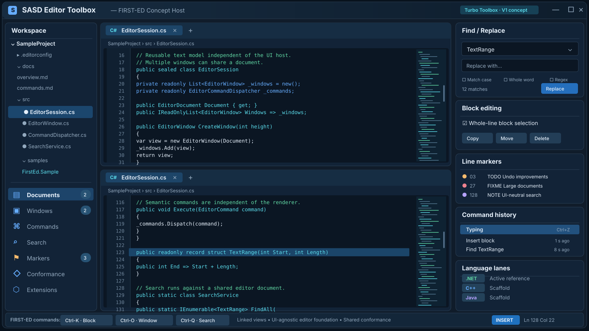

# SASD Editor Toolbox

**SASD Editor Toolbox** is a reusable, UI-agnostic editing foundation for SASD applications and tools. C#/.NET is the first active reference implementation, while the repository is now explicitly structured for peer implementations in C++, Java and additional languages without redesigning the project.

The long-term goal is broader than a stand-alone text editor: the toolbox should provide reusable document, buffer, command, search, block, window, undo, rendering-model and extension infrastructure that can be embedded in SASD Workbench applications.

## Editor UI preview (concept)



> **Design concept, not an application screenshot.** This illustration shows a possible graphical host for the UI-agnostic Editor Toolbox: linked document windows, command dispatch, text search, block editing, line markers and cross-language development. The current runnable FIRST-ED reference host is terminal-based; the illustrated GUI and its sample values are not claims of implemented features.

## V1 target: Turbo Editor Toolbox compatibility set

Version 1 uses the functional scope of Borland's historical **Turbo Editor Toolbox 1.0 (1985)** as a compatibility/reference milestone. This is a **clean-room reimplementation**: the historical handbook is treated as a behavioral requirements source; historical source code is not copied.

The historical design is especially useful because it separates the editor into text streams, windows, command dispatchers/processors, hooks, file operations, screen updating, buffered input and a cooperative background task mechanism. SASD keeps those responsibilities, but exposes them through modern, testable abstractions rather than DOS/video-memory-specific code.

## Repository architecture

```text
SASD-Editor-Toolbox/
├── src/
│   ├── dotnet/                        # active C#/.NET reference implementation
│   ├── cpp/                           # C++ implementation root (scaffold)
│   └── java/                          # Java implementation root (scaffold)
├── tests/
│   ├── dotnet/
│   ├── cpp/
│   └── java/
├── samples/
│   ├── dotnet/
│   ├── cpp/
│   └── java/
├── spec/                              # normative language-neutral behavior
├── conformance/                       # shared machine-readable behavior cases
├── docs/
│   ├── en/                            # primary technical documentation
│   └── de/                            # German documentation
├── tools/                             # repository-wide verification helpers
└── .github/workflows/
```

Language implementations are peers. No implementation is allowed to become a runtime dependency of another implementation. Portable observable behavior belongs in `spec/`; reusable cross-language examples belong in `conformance/`. The .NET implementation is currently the most complete executable reference, but it is not the normative specification.

## Cross-language development model

The repository separates the **portable editor contract** from **language-specific implementation choices**:

- `spec/editor-v1.md` is the normative V1 behavior contract.
- `conformance/` contains implementation-neutral cases that every language runner can consume.
- `src/<language>`, `tests/<language>` and `samples/<language>` form one self-contained implementation lane.
- `implementations.json` records which language lanes exist and their maturity without implying API-name identity.
- Each language may use idiomatic APIs, containers, ownership models and build systems as long as externally observable editor behavior remains compatible.
- A semantic change is made in the shared contract first, then reflected in conformance cases and each affected implementation.

See the English and German multi-language architecture documents for the porting and synchronization rules.

## Implemented foundation

The current foundation contains:

- a line-oriented text-buffer abstraction with a linked-line implementation;
- historical user-colored line/stream annotations as UI-neutral flags, preserving block/wrap metadata across linked windows;
- document and multi-window/session models, including linked windows over one document;
- host-neutral stacked-window geometry through `EditorWindowLayout` / `EditorWindowFrame`;
- historical Create Window compression/splitting and Delete Window row-reclamation rules with a three-row minimum per displayed window;
- destructive `EditWindowDeleteText` semantics: blank `NONAME`, linked-stream detachment, block cleanup and no undo resurrection;
- cursor movement, insertion/overtype, newline, auto-indent, word-wrap and tab handling;
- historical FIRST-ED character-left/right behavior, including last-nonblank cross-line movement and persistent virtual right-hand columns, isolated in a primitive compatibility adapter;
- historical FIRST-ED left/right word movement using alphanumeric, punctuation and blank classes plus the documented line-boundary rules;
- insert/overtype-aware historical Tab behavior: Insert mutates text, Overtype moves only the cursor;
- distinct historical `EditInsertLine` and `EditNewLine` semantics, including Ctrl-N versus Return, three-way line splitting, Overtype Return, Autoindent and `Wrapped` reset;
- explicit `Wrapped` semantics as a soft outgoing word-wrap boundary, aligned across automatic wrapping, reformatting and the legacy high-bit-CR file codec;
- historical FIRST-ED begin/end/goto, top/bottom-file and viewport-aware movement semantics isolated behind compatibility processors;
- display-row-aware line scrolling and page movement supplied with a host-visible row count;
- a host-neutral all-window horizontal cursor visibility rule and indexed absolute-line status projection, replacing DOS-era screen-scanning helpers;
- audited left/right character deletion, right-word deletion and line deletion, including cursor-positioned line joins and the sole-line blanking rule;
- change-case and centering plus a clean-room FIRST-ED paragraph reformatter covering the observable responsibilities of `EditCompressLine`, `EditShiftLine`, `EditLongLine`, `EditShortLine` and `EditReformat`;
- atomic reformat planning with margin validation, word push-down/pull-up, hard paragraph boundaries, one undo snapshot and no partial mutation for a word-too-long failure;
- a central `EditorLineTopology` service that realigns window cursors/top-line anchors, markers and block limits for audited structural insert/delete operations;
- structural realignment for Insert Line, New Line, automatic word-wrap, compatibility file reads, paragraph reformatting and character/word line joins;
- marker invalidation and block-boundary cleanup on audited line deletion paths;
- audited whole-line block copy/move/delete with cross-window/document operation, move-inside-block rejection, line-metadata preservation and bulk topology realignment;
- independent FIRST-ED block-begin/block-end endpoint state through `EditorBlockState`, with a complete `EditorBlock` projection only when both limits form a valid contiguous range;
- whole-line block begin/end/hide state plus block-boundary navigation;
- `EditOffblock`/`EditMarkblock`-style separation of logical block limits from global `InBlock` highlight flags;
- numbered line markers whose jumps preserve the selected target view's current column;
- correctness-first transactional snapshot undo with a configurable limit, one logical history item for cross-document mutations, and post-state-aware restoration of linked-window/marker/block navigation state;
- literal forward find/replace services plus remembered FIRST-ED Find Again state;
- modern asynchronous UTF-8 document persistence through `ITextStorage` / `FileTextStorage`;
- historical read/write command semantics through `EditorFileService`;
- a dedicated `FirstEdLegacyFileCodec` preserving the historical `0x8D` wrapped-line marker without imposing that format on modern storage;
- semantic command requests and a dispatcher separated from editing primitives;
- centralized host-neutral command-boundary validation for required arguments, stable numeric ranges, page sizes, marker numbers, search/replace values and file paths before mutation/I/O;
- typed host-neutral error IDs, stable machine codes and resource keys so terminal, desktop, web and future language ports can render failures independently;
- a UI-neutral key-stroke model plus the FIRST-ED Ctrl-K/Ctrl-O/Ctrl-Q and primary-key mapping contract;
- a bounded 500-entry `EditorTypeaheadBuffer` with host FIFO input, front injection for macros, overflow clearing and the historical immediate host Ctrl-U abort boundary;
- `EditorInterruptionService` as the host-neutral EditBreathe modernization: long operations can poll bounded host input, translate Ctrl-U into a one-shot editor abort, and keep platform `CancellationToken` cancellation semantically separate;
- typed prompt metadata so keyboard mapping remains independent of UI prompting;
- window up/down/goto semantics and historical stream linking by reattaching an existing view to a shared document;
- an explicit rundown state corresponding to the historical `Rundown` flag;
- `EditorScheduler` and `EditorSystemLoop` implementing input-first cooperative scheduling and the repeated schedule-until-rundown main-loop model;
- `IEditorInputPump` as the host boundary for keyboard, terminal, scripted or other input sources;
- extension hooks inspired by the historical `UserCommand`, `UserError`, `UserStatusLine`, `UserReplace` and `UserTask` integration points;
- a UI-neutral viewport/status model with a specific-window projection for simultaneous multi-window rendering;
- an **interactive stacked FIRST-ED terminal reference host** whose physical and macro input share the editor-owned typeahead path before key mapping and dispatch;
- English and German architecture/compatibility documentation;
- automated unit tests.

The [123-entry historical V1 procedure/function inventory](docs/en/HANDBOOK-PROCEDURE-INDEX-AUDIT.md) and [German companion](docs/de/HANDBUCH-PROZEDURENINDEX-AUDIT.md) now classify every indexed routine. This closes the first-pass inventory, **not** the final behavioral parity or regression-coverage review. Multi-line block topology, independent historical `Blockfrom`/`Blockto` endpoint state, command-boundary validation, typed errors/resources, abort/interruptibility and compound undo/navigation-state restoration are covered. The next release-gate item is a targeted verification of the first-pass handbook mappings against tests and host-level behavior. MicroStar-specific UI features can remain samples rather than dependencies of the reusable core.

## Run the interactive FIRST-ED sample

```bash
dotnet run --project samples/dotnet/Sasd.Editor.FirstEd.Sample/Sasd.Editor.FirstEd.Sample.csproj
```

The sample starts with Window 1 editing `NONAME`. Historical Ctrl-K / Ctrl-O / Ctrl-Q sequences are accepted alongside modern cursor keys. **Ctrl-O O** creates a stacked window by asking for its screen-row count and donor window number; **Ctrl-O Y** deletes a window. Use **Ctrl-K X**, then type **YES**, to exit.

## Build the .NET reference implementation

```bash
dotnet restore Sasd.Editor.Toolbox.slnx
dotnet build Sasd.Editor.Toolbox.slnx --configuration Release
dotnet test Sasd.Editor.Toolbox.slnx --configuration Release
```

Target framework: **.NET 10**.

The language-neutral repository contract can be checked independently of any implementation:

```bash
python3 tools/verify_repository_contract.py
```

Future C++ and Java builds will live entirely inside their own implementation lanes and receive separate CI jobs; they will not be coupled to the .NET build graph.

## Design rules

- Core editing logic in every language remains UI-agnostic; platform hosts live under samples or host-specific packages, not in the reusable core.
- No language implementation may depend on another language implementation at runtime.
- Portable behavior changes start in `spec/` and, where practical, receive shared conformance cases before implementation-specific code changes.
- A document and its views/windows are separate concepts; multiple windows may share one document.
- Physical row allocation is kept in a host-neutral layout service rather than embedded in a console renderer.
- Mutation APIs own dirty-state and undo integration; deliberately destructive compatibility commands explicitly discard obsolete undo state.
- Historical input/value conventions and unusual FIRST-ED cursor/word semantics live in compatibility services instead of leaking DOS-era choices into the general text engine.
- Structural line changes use an explicit topology/anchor boundary rather than scattering marker/window/block index repair across commands.
- `Wrapped` denotes the soft outgoing boundary after a logical line; it is paragraph structure, not merely a display hint.
- Virtual non-negative columns are valid editor state and are not silently collapsed by structural line normalization.
- The typeahead compatibility layer stores normalized key strokes, not DOS bytes or raw scan codes.
- Historical pointer/free-list mechanics are not public API requirements; observable document, marker, block and window invariants are the compatibility target.
- Historical names are documented as compatibility references, not copied as a 1:1 public API.
- Platform-specific rendering stays outside the core; keyboard events are normalized before entering typeahead/key mapping.
- Key maps declare required prompt arguments but never display prompts themselves.
- Historical byte-level file compatibility is isolated behind a codec and does not replace modern UTF-8 storage.
- Scheduler/background work remains cooperative and bounded; platform input stays behind `IEditorInputPump`.
- Expensive optimizations (rope/piece-table buffers, indexed anchors, lock-free queues, SIMD search, native backends) are introduced only behind stable interfaces and after profiling.
- The first implementation favors correctness, reviewability and tests over premature micro-optimization.

## Documentation

- English architecture: [`docs/en/ARCHITECTURE.md`](docs/en/ARCHITECTURE.md)
- Deutsche Architektur: [`docs/de/ARCHITECTURE.md`](docs/de/ARCHITECTURE.md)
- Multi-language development: [`docs/en/MULTI-LANGUAGE-DEVELOPMENT.md`](docs/en/MULTI-LANGUAGE-DEVELOPMENT.md)
- Mehrsprachige Entwicklung: [`docs/de/MEHRSPRACHIGE-ENTWICKLUNG.md`](docs/de/MEHRSPRACHIGE-ENTWICKLUNG.md)
- Shared conformance cases: [`conformance/README.md`](conformance/README.md)
- Specification guide: [`spec/README.md`](spec/README.md)
- V1 compatibility matrix: [`docs/en/BORLAND-V1-COMPATIBILITY.md`](docs/en/BORLAND-V1-COMPATIBILITY.md)
- Deutsche V1-Matrix: [`docs/de/BORLAND-V1-KOMPATIBILITAET.md`](docs/de/BORLAND-V1-KOMPATIBILITAET.md)
- FIRST-ED command map: [`docs/en/FIRST-ED-COMMAND-MAP.md`](docs/en/FIRST-ED-COMMAND-MAP.md)
- FIRST-ED-Befehle: [`docs/de/FIRST-ED-BEFEHLE.md`](docs/de/FIRST-ED-BEFEHLE.md)
- Command-processor transfer: [`docs/en/COMMAND-PROCESSOR-TRANSFER.md`](docs/en/COMMAND-PROCESSOR-TRANSFER.md)
- Command-Prozessor-Übertragung: [`docs/de/COMMAND-PROCESSOR-UEBERTRAGUNG.md`](docs/de/COMMAND-PROCESSOR-UEBERTRAGUNG.md)
- Command-boundary validation: [`docs/en/COMMAND-BOUNDARY-VALIDATION.md`](docs/en/COMMAND-BOUNDARY-VALIDATION.md)
- Befehlsgrenzen-Validierung: [`docs/de/BEFEHLSGRENZEN-VALIDIERUNG.md`](docs/de/BEFEHLSGRENZEN-VALIDIERUNG.md)
- Error/resource model: [`docs/en/ERROR-MODEL.md`](docs/en/ERROR-MODEL.md)
- Fehler-/Ressourcenmodell: [`docs/de/FEHLERMODELL.md`](docs/de/FEHLERMODELL.md)
- Interruptibility and Ctrl-U: [`docs/en/INTERRUPTIBILITY.md`](docs/en/INTERRUPTIBILITY.md)
- Unterbrechbarkeit und Ctrl-U: [`docs/de/UNTERBRECHBARKEIT.md`](docs/de/UNTERBRECHBARKEIT.md)
- Compound undo transactions: [`docs/en/UNDO-TRANSACTIONS.md`](docs/en/UNDO-TRANSACTIONS.md)
- Zusammengesetzte Undo-Transaktionen: [`docs/de/UNDO-TRANSAKTIONEN.md`](docs/de/UNDO-TRANSAKTIONEN.md)
- Search and file commands: [`docs/en/SEARCH-AND-FILE-COMMANDS.md`](docs/en/SEARCH-AND-FILE-COMMANDS.md)
- Suchen und Datei-Befehle: [`docs/de/SUCHEN-UND-DATEI-BEFEHLE.md`](docs/de/SUCHEN-UND-DATEI-BEFEHLE.md)
- Lifecycle and scrolling: [`docs/en/LIFECYCLE-AND-SCROLLING.md`](docs/en/LIFECYCLE-AND-SCROLLING.md)
- Lifecycle und Scrollen: [`docs/de/LIFECYCLE-UND-SCROLLEN.md`](docs/de/LIFECYCLE-UND-SCROLLEN.md)
- Interactive FIRST-ED host: [`docs/en/INTERACTIVE-FIRST-ED-HOST.md`](docs/en/INTERACTIVE-FIRST-ED-HOST.md)
- Interaktiver FIRST-ED-Host: [`docs/de/INTERAKTIVER-FIRST-ED-HOST.md`](docs/de/INTERAKTIVER-FIRST-ED-HOST.md)
- Window geometry: [`docs/en/WINDOW-GEOMETRY.md`](docs/en/WINDOW-GEOMETRY.md)
- Fenstergeometrie: [`docs/de/FENSTER-GEOMETRIE.md`](docs/de/FENSTER-GEOMETRIE.md)
- Typeahead and window-text deletion: [`docs/en/TYPEAHEAD-AND-WINDOW-TEXT.md`](docs/en/TYPEAHEAD-AND-WINDOW-TEXT.md)
- Typeahead und Fenstertext-Löschung: [`docs/de/TYPEAHEAD-UND-FENSTERTEXT.md`](docs/de/TYPEAHEAD-UND-FENSTERTEXT.md)
- Kernel compatibility audit: [`docs/en/KERNEL-COMPATIBILITY-AUDIT.md`](docs/en/KERNEL-COMPATIBILITY-AUDIT.md)
- Kernel-Kompatibilitätsaudit: [`docs/de/KERNEL-KOMPATIBILITAETSAUDIT.md`](docs/de/KERNEL-KOMPATIBILITAETSAUDIT.md)
- Line topology and realignment: [`docs/en/LINE-TOPOLOGY-AND-REALIGNMENT.md`](docs/en/LINE-TOPOLOGY-AND-REALIGNMENT.md)
- Zeilentopologie und Realignment: [`docs/de/ZEILENTOPOLOGIE-UND-REALIGNMENT.md`](docs/de/ZEILENTOPOLOGIE-UND-REALIGNMENT.md)
- Deletion compatibility: [`docs/en/DELETION-COMPATIBILITY.md`](docs/en/DELETION-COMPATIBILITY.md)
- Löschbefehle-Kompatibilität: [`docs/de/LOESCHBEFEHLE-KOMPATIBILITAET.md`](docs/de/LOESCHBEFEHLE-KOMPATIBILITAET.md)
- Line insertion and New Line: [`docs/en/LINE-INSERTION-AND-NEWLINE.md`](docs/en/LINE-INSERTION-AND-NEWLINE.md)
- Zeileneinfügung und Neue Zeile: [`docs/de/ZEILENEINFUEGUNG-UND-NEUE-ZEILE.md`](docs/de/ZEILENEINFUEGUNG-UND-NEUE-ZEILE.md)
- Reformat compatibility: [`docs/en/REFORMAT-COMPATIBILITY.md`](docs/en/REFORMAT-COMPATIBILITY.md)
- Neuformatierungs-Kompatibilität: [`docs/de/NEUFORMATIERUNG-KOMPATIBILITAET.md`](docs/de/NEUFORMATIERUNG-KOMPATIBILITAET.md)
- Block compatibility: [`docs/en/BLOCK-COMPATIBILITY.md`](docs/en/BLOCK-COMPATIBILITY.md)
- Block-Kompatibilität: [`docs/de/BLOCK-KOMPATIBILITAET.md`](docs/de/BLOCK-KOMPATIBILITAET.md)
- Screen position compatibility (EN): [`docs/en/SCREEN-POSITION-COMPATIBILITY.md`](docs/en/SCREEN-POSITION-COMPATIBILITY.md)
- Bildschirmposition-Kompatibilität (DE): [`docs/de/BILDSCHIRMPOSITION-KOMPATIBILITAET.md`](docs/de/BILDSCHIRMPOSITION-KOMPATIBILITAET.md)
- Language-neutral V1 contract: [`spec/editor-v1.md`](spec/editor-v1.md)

## License

MIT. See [`LICENSE`](LICENSE).
